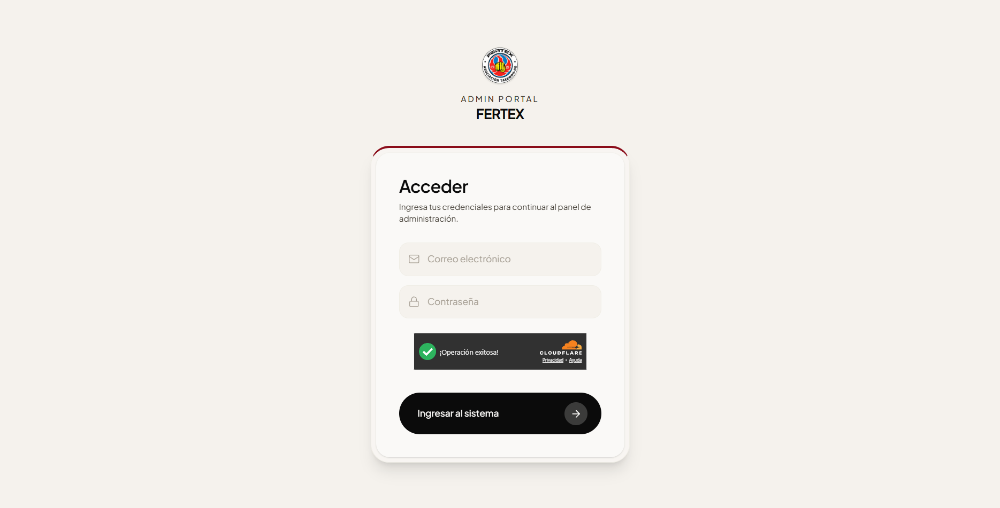
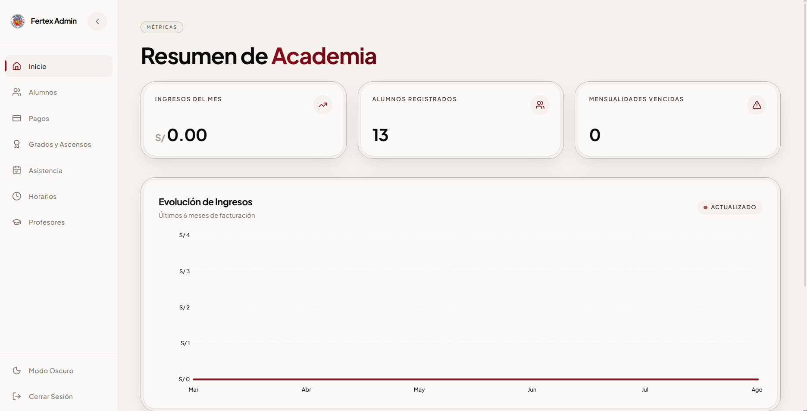
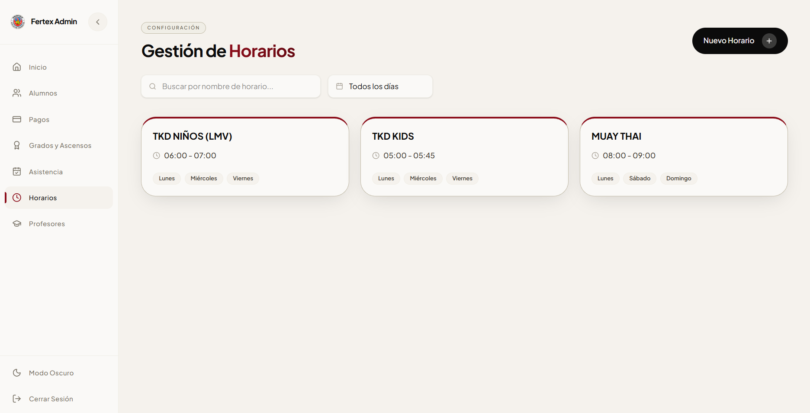
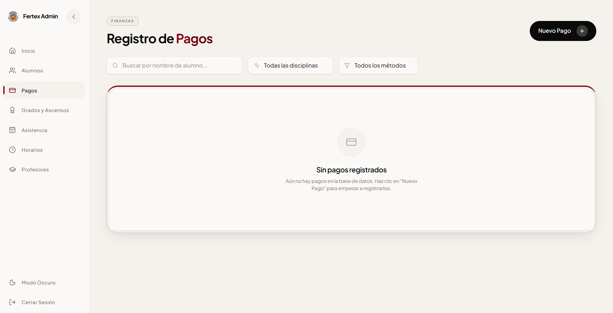

# 🥋 Sistema de Gestión para Academia de Taekwondo




Una plataforma web integral y moderna diseñada específicamente para la administración eficiente de academias y dojangs de Taekwondo. Este sistema centraliza la gestión de alumnos, asistencias, pagos, rangos (cinturones) y horarios en una única interfaz intuitiva, permitiendo a los instructores y administradores enfocarse en lo que más importa: la enseñanza.

## ✨ Características Principales

* **Dashboard Interactivo:** Panel principal con métricas clave y gráficos (impulsados por Recharts) para una visión general del estado de la academia.
* **Gestión de Alumnos y Profesores:** Registro y administración completa de la información del personal y los estudiantes.
* **Control de Asistencia:** Sistema ágil para registrar y monitorear la asistencia a las clases.
* **Progresión de Cinturones:** Seguimiento del historial de grados, exámenes y promociones de cada alumno.
* **Gestión de Pagos:** Control de mensualidades, inscripciones, generación de recibos y reportes financieros (exportables a PDF gracias a jsPDF).
* **Horarios de Clases:** Organización y visualización de las diferentes clases y turnos.
* **Seguridad y Autenticación:** Acceso seguro al sistema gestionado por Supabase Auth y protegido contra bots mediante Cloudflare Turnstile.


## 📸 Capturas de Pantalla

| Dashboard | Gestión de Horarios | Control de Pagos |
| :---: | :---: | :---: |
|  |  |  |

## 🚀 Tecnologías Utilizadas

Este proyecto está construido con un stack moderno, priorizando el rendimiento, la escalabilidad y una experiencia de usuario fluida:

**Frontend:**
*   [React 19](https://react.dev/) - Librería principal para la construcción de interfaces.
*   [Vite](https://vitejs.dev/) - Entorno de desarrollo ultrarrápido y empaquetador.
*   [Tailwind CSS (v4)](https://tailwindcss.com/) - Framework de utilidades CSS para un diseño ágil y moderno.
*   [React Router](https://reactrouter.com/) - Enrutamiento dinámico en la aplicación cliente.
*   [Recharts](https://recharts.org/) - Gráficos y visualización de datos.
*   [jsPDF](https://parall.ax/products/jspdf) - Generación de documentos PDF en el cliente.
*   [Lucide React](https://lucide.dev/) - Sistema de íconos hermoso y consistente.

**Backend & Servicios:**
*   [Supabase](https://supabase.com/) - Backend como servicio (BaaS) open source (Base de datos PostgreSQL, Autenticación, Row Level Security).

## 🛠️ Instalación y Configuración Local

Sigue estos pasos para ejecutar el proyecto en tu entorno local:

### Requisitos Previos
*   Node.js (versión recomendada LTS)
*   npm (o yarn, pnpm)
*   Un proyecto creado en Supabase

### Pasos

1. **Clonar el repositorio:**
   ```bash
   git clone https://github.com/jhefferson-guerrero/sistema-taekwondo.git
   cd sistema-taekwondo
   ```

2. **Instalar dependencias:**
   ```bash
   npm install
   ```

3. **Configurar Variables de Entorno:**
   Crea un archivo llamado `.env` en la carpeta principal del proyecto (raíz) y añade las siguientes variables con tus credenciales de Supabase:
   ```env
   VITE_SUPABASE_URL=tu_supabase_url
   VITE_SUPABASE_ANON_KEY=tu_supabase_anon_key
   ```

4. **Iniciar el servidor de desarrollo:**
   ```bash
   npm run dev
   ```


## 📜 Scripts Disponibles

En el directorio del proyecto, puedes ejecutar:

*   `npm run dev`: Ejecuta la app en modo desarrollo (Vite).
*   `npm run build`: Construye la aplicación para producción en la carpeta `dist`.
*   `npm run lint`: Ejecuta el linter (Oxlint) para detectar problemas en el código.
*   `npm run preview`: Previsualiza el build de producción localmente.

